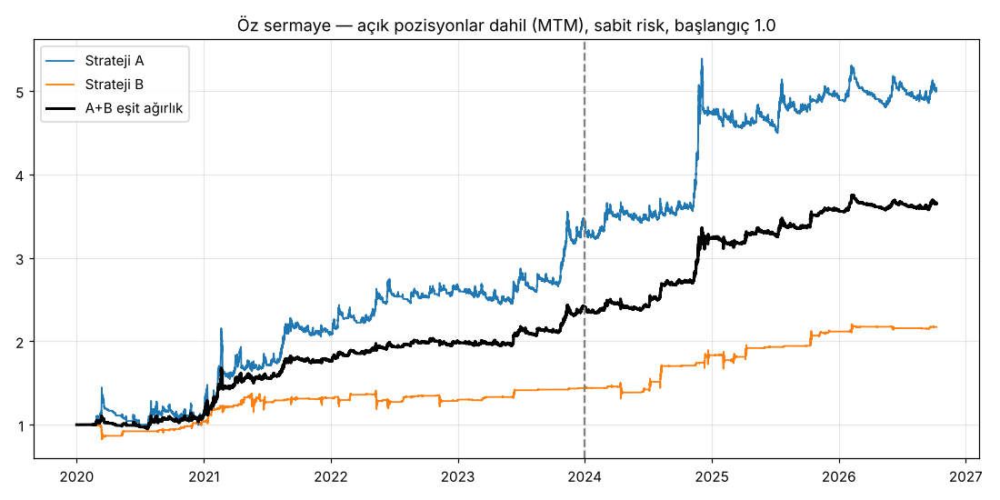

# Kripto Algoritmik Trading Sistemi — Strateji Raporu

**Kapsam:** Binance USDT-M perpetual vadeli işlemlerinde, işlem hacmine göre ilk 25 coin.
Yön 1D/4H zaman diliminden belirlenir, işlemler 1H mumda açılır.
**Veri:** 2020-01 → 2026-10 arası saatlik mumlar ve funding oranları (`data/`).
**Test bölümleri:**
- **IS** (in-sample, optimizasyon dönemi): 2020–2023
- **OOS** (out-of-sample, optimizasyonda kullanılmayan dönem): 2024–2026-10

**Maliyetler:** taraf başına %0.07 (taker komisyonu + kayma) ve gerçek saatlik funding uygulanır.

Kısaltmalar:
- **WR:** kazanma oranı (net kârla kapanan işlemlerin yüzdesi)
- **PF:** kâr faktörü (toplam kâr / toplam zarar)
- **R:** işlem başına riske edilen tutar (giriş ile stop arasındaki mesafe)
- **DD:** en büyük düşüş (zirveden dibe öz sermaye kaybı)

## 1. Dokümanlardan çıkan ortak payda

19 doküman `metinler/` klasörüne çevrildi ve tarandı. Stratejiler aşağıdaki ortak ilkelere dayanıyor.

| İlke | Kaynaklar |
|---|---|
| Bir gösterge trend yönünü doğrular, diğeri giriş sinyalini verir (üst zaman dilimi + alt zaman dilimi) | Ratford (Algoritmik Trading Stratejileri), Kılınçarslan (tez: "önce geniş, sonra orta, sonra kısa perspektif"), Price Action Algo (HTF top-down) |
| Kanal/Donchian kırılımı ile trend takibi; büyük mumlarda kırılımlar kârlı, küçük mumlarda sahte | Pruitt (Turtle, Donchian kanalı karşılaştırması), Davey (bar boyutu çalışması), D'errico |
| Ortalamadan aşırı uzaklaşma (MA stretch), en iyi ortalamaya dönüş yöntemi | Davey (Bölüm 5: #4 MA Stretch en iyisi), Connors RSI, Bollinger stretch |
| Çıkış: hedef/stop yerine teknik çıkış ve stop & reverse; başabaş stop neredeyse onun kadar iyi; hızlı çıkışlar ve kısa süreli zaman çıkışları kötü | Davey (Bölüm 8 çıkış testleri) |
| Rejim filtresi (boğa/ayı piyasası) net kârı artırıp düşüşü azaltır | Davey (Bölüm 7), Pruitt |
| Maliyetleri dahil et, örneklem dışı (OOS) test yap, aşırı optimizasyondan kaçın | Davey, Pruitt, Jansen, Kılınçarslan |

### Test edilip elenen fikirler

Sonuçlar `results/grid_*.csv` dosyalarında. Hepsi maliyetler düşüldükten sonra kâr faktörü 1'in altında kaldı veya OOS döneminde çöktü.

- **1H RSI/Bollinger ile trend yönünde geri çekilme** (Ratford, Davey MR #1/#3): PF < 1.
- **1H Donchian kırılımı:** Davey'in "küçük mumlarda kırılımlar sahtedir" bulgusuyla tutarlı şekilde zarar etti.
- **Fibonacci %50–61.8 ölçülü hareket geri çekilmesi** (Halsey, Altın Oran, Price Action prim/indirim bölgesi): IS'te zayıf kâr, OOS'ta PF yaklaşık 0.85.
- **4H kırılım sonrası 1H geri test girişi:** anında girişe göre belirgin şekilde kötü.
- **24 saatlik momentum patlaması:** kazanma oranı %45'in altında, OOS'ta zayıf.

**Teşhis bulgusu:** basit bir "günlük EMA üstünde/altında" trend filtresinin 2024–26 döneminde ileriye dönük getiriyi tahmin gücü yok. Anlamlı ve iki dönemde de tutarlı olan yalnızca aşırı uçlar:
- kırılım ve momentum devamı,
- coin'e özgü kapitülasyon (sert düşüş) sonrası dönüş.

## 2. Nihai sistem: iki bağımsız strateji

> **Denetim notu:** ilk sürümdeki C stratejisi, işlemlerinin %95'inde A ile aynı coin'de aynı yönde pozisyon tutuyordu (korelasyon 0.77). Bu yüzden ayrı bir strateji olmaktan çıkarılıp A'nın ikinci giriş modülü (A2) yapıldı. Tüm bulgular `DENETIM.md` dosyasında.

Parametreler `algo/final.py` dosyasında. Sonuçları yeniden üretmek için:
- ana evren: `python -m algo.report`
- stres evreni: `ALGO_DATA=data_extra python -m algo.report stress`

### Strateji A — Trend Kırılımı (iki giriş modülü, ortak risk)

İki modül aynı risk bütçesini paylaşır ve bir coin'de aynı anda yalnızca bir pozisyon açılır.

**A1 — 4H Donchian + hacim**
- **Yön (1D/4H):**
  - **Long:** 4H kapanış önceki 20 adet 4H mumun en yükseğini kırar, 4H hacim son 20 mumun ortalamasının en az 1.5 katıdır, 4H kapanış EMA100'ün üstündedir ve BTC günlük kapanışı EMA200'ün üstündedir.
  - **Short:** 4H kapanış önceki 20 mumun en düşüğünü aynı hacim koşuluyla kırar ve EMA100'ün altındadır. Short tarafında BTC filtresi yok.
- **Giriş (1H):** sinyalden sonraki ilk 1H mumun açılışında.
- **Stop:** 2 × ATR14 (4H). Turtle'daki "2N" kuralı.
- **Çıkış:**
  1. Pozisyonun %25'i 1R kârda kapatılır ve stop başabaşa çekilir.
  2. Kalan pozisyon için iz süren stop: en iyi fiyattan 10 × ATR (4H) geride.
  3. 4H kapanış EMA100'ün ters tarafına geçerse pozisyon kapanır.
  4. En fazla 720 saat tutulur.

**A2 — Günlük Donchian (Turtle)**
- **Yön (1D):**
  - **Long:** günlük kapanış önceki 20 günün en yükseğini kırar, 4H kapanış EMA200'ün üstündedir ve BTC günlük kapanışı EMA200'ün üstündedir.
  - **Short:** günlük kapanış önceki 20 günün en düşüğünü kırar ve 4H kapanış EMA200'ün altındadır.
- **Giriş (1H):** günlük kapanıştan sonraki ilk 1H mumun açılışında.
- **Stop:** 4 × ATR (4H).
- **Çıkış:** pozisyonun %25'i 1R'de kapatılır ve stop başabaşa çekilir; kalan pozisyon için iz süren stop 15 × ATR (4H); 4H kapanış EMA200'ün ters tarafına geçerse pozisyon kapanır; en fazla 720 saat.

**Risk:** işlem başına %0.5, aynı anda en fazla 10 pozisyon.

### Strateji B — Kapitülasyon Dönüşü (yalnızca long)

- **Yön (1D):** coin'in son 24 saatlik basit getirisi −%15'ten kötüdür.
- **Giriş (1H):** koşulun oluştuğu mumdan sonraki ilk 1H mumun açılışında.
- **Stop:** 4 × ATR14 (4H). 1R kâra ulaşılınca stop başabaşa çekilir.
- **Çıkış:** 96 saat sonra (zaman çıkışı) ya da stop ile.
- **Risk:** işlem başına %0.75, aynı anda en fazla 25 pozisyon.

## 3. Sonuçlar (maliyet, funding ve portföy sınırları dahil)

### Ana evren (25 coin) — işlem bazında

| | İşlem sayısı | WR tüm dönem | WR IS / OOS | PF tüm dönem | PF IS / OOS | Kârlı coin |
|---|---|---|---|---|---|---|
| **A** (A1 2877 + A2 270 işlem) | 3 147 | **%50.1** | %51.4 / %48.5 | **1.61** | 1.66 / 1.55 | 21/25 |
| **B** | 996 | **%64.0** | %60.8 / %69.8 | **1.78** | 1.41 / 2.67 | 24/25 |

### Stres evreni (20 hiç görülmemiş eski/delist edilmiş coin, parametreler aynı)

| | İşlem sayısı | WR | PF | PF IS / OOS | Kârlı coin |
|---|---|---|---|---|---|
| **A** | 2 781 | **%48.6** | **1.40** | 1.24 / 1.62 | 17/20 |
| **B** | 1 007 | **%60.2** | **1.65** | 1.45 / 2.40 | 19/20 |

### Yıllara göre (ana evren, WR / PF)

| Yıl | A | B |
|---|---|---|
| 2020 | %46.5 / 1.17 | %66.4 / 1.19 |
| 2021 | %53.1 / 2.04 | %58.8 / 1.60 |
| 2022 | %59.7 / 1.91 | %56.0 / **0.95** |
| 2023 | %49.1 / 1.58 | %82.9 / 16.7 |
| 2024 | %51.5 / 2.21 | %69.4 / 2.85 |
| 2025 | %50.6 / 1.17 | %72.9 / 2.55 |
| 2026* | **%39.6** / 1.14 | %61.7 / 2.31 |

\* 2026 yılı 8 Ekim'e kadar.

### Portföy — açık pozisyonlar dahil (MTM), sabit risk

| | Yıllık getiri (bileşiksiz) | En büyük düşüş (MTM) | Sharpe | Getiri / düşüş |
|---|---|---|---|---|
| A | %26.9 | −%34.2 | 0.99 | 0.78 |
| B | %12.1 | −%18.5 | 0.86 | 0.66 |
| **A+B eşit ağırlık (ana evren)** | **%21.1** | **−%15.2** | **1.45** | 1.39 |
| A+B eşit ağırlık (stres evreni) | %17.2 | −%12.7 | 1.30 | 1.36 |

- **A–B günlük getiri korelasyonu:** −0.27.
- **Kombine yıllık getiri (ana evren):** 2020 +%13, 2021 +%57, 2022 +%13, 2023 +%20, 2024 +%35, 2025 +%10, 2026 (ilk 9 ay) +%2.

## 4. Sağlamlık kontrolleri

- **Stres evreni:** 20 coin, parametreler hiç değiştirilmeden. İki stratejide de WR ≥ %45 ve PF ≥ 1.40.
- **Parametre platosu:**
  - A'nın 144 komşu parametre setinde getiri/düşüş oranının medyanı 1.15; hiçbiri zararda değil.
  - B'de düşüş eşiği %13–16 arasında PF düzgün ve tek yönlü değişiyor (1.58 → 1.89).
- **Gecikme testi:** girişler 1–2 saat geciktirilince PF sadece hafif düşüyor (A1 1.45→1.39–1.41, A2 1.47→1.46–1.48, B 1.78→1.65–1.70).
- **İleriye bakma yanlılığı yok:** üst zaman dilimi verisi bir 1H muma o mum kapandıktan sonra aktarılır. Giriş sonraki mumun açılışından yapılır. Aynı mumda hem stop hem hedef görülürse önce stop varsayılır.
- **Birim testleri:** `python -m pytest -q tests` (8 test).

## 5. Bilinen riskler ve sınırlamalar

1. **A'nın kârı az sayıda dev trendden geliyor.** Trend takibinin doğası böyle: 2026'da WR %39.6'ya düştü (PF yine de 1.14). Dev trend olmayan dönemlerde A yatay seyreder.
2. **B'nin zayıf yılı 2022.** Ayı piyasasında çöküşler devam etti; PF 0.95. Stoplar kayıpları sınırladı (LUNA: yaklaşık −2R).
3. **B'nin OOS sonuçları IS'ten daha iyi** (PF 2.67'ye karşı 1.41). Bu dönemsel bir şans olabilir; gerçekçi beklenti PF 1.4–1.8 arası.
4. **Bilinçli PDF sapmaları.** Turtle çıkışı, Davey'in MR zaman çıkışı uyarısı ve Davey #5'in zayıflığı test edildi; verinin gösterdiği tercih edildi. Ayrıntılar `DENETIM.md` §2'de.
5. **Canlı ortam farkları.** Sert hareketlerde kayma %0.07'den yüksek olabilir. Gerçek parayla başlamadan önce 1–3 ay paper trading önerilir (Ratford, Davey, Kılınçarslan).

## 6. Dosya haritası

- `DENETIM.md`: bug / mükerrerlik / çelişki / PDF uygunluk denetimi
- `metinler/`: PDF'lerden çıkarılan metinler
- `data/`, `data_extra/`: Binance 1h kline ve funding verisi
- `algo/final.py`: nihai A1/A2/B parametreleri ve risk kolları
- `algo/strategies.py`: s4 (B), s5 (A1/A2); s1–s3 araştırmada elenen stratejiler
- `algo/backtest.py`: numba ile işlem simülatörü
- `algo/portfolio.py`: portföy simülasyonu ve açık pozisyonlar dahil düşüş hesabı
- `algo/report.py`: sonuçları yeniden üretme
- `tests/`: simülatör birim testleri
- `results/`: parametre taramaları, işlem listeleri, `final_*` / `stress_*` özetleri ve grafikler
