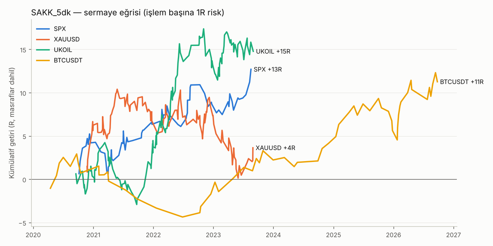
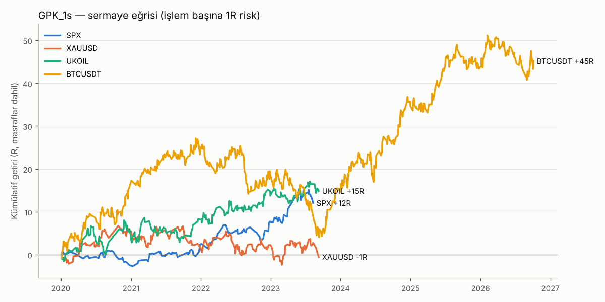

# Strateji Geliştirme ve Backtest Raporu

**Amaç:** `metinler/` klasöründeki 4 kitabın ortak paydasından iki strateji üretmek:
**(1)** 5 dakikalık grafikte scalp, **(2)** 1 saatlik grafikte day trade.
**Hedef:** masraflar dahil kazanma oranı **≥ %45** ve **net kârlılık**. Kural: *"Kârlıysa kullanırız."*
**Enstrümanlar:** XU030, SPX, XAUUSD, UKOIL, BTCUSDT, en erken 01.01.2020.

---

## 1. Sonuç özeti

| Strateji | SPX | UKOIL | BTCUSDT | XAUUSD | XU030 |
|---|---|---|---|---|---|
| **SAKK – 5 dk** | ✅ %60,5 / PF 1,62 | ✅ %54,0 / PF 1,32 | ✅ %57,4 / PF 1,44 | ❌ OOS'ta zararda | ⚠ veri yok |
| **GPK – 1 s** | ✅ %56,0 / PF 1,38 | ✅ %52,2 / PF 1,21 | ✅ %45,5 / PF 1,19 | ❌ PF 0,99 | ⚠ veri yok |

(kazanma oranı / kâr faktörü; tüm dönem, masraflar dahil)

- İki strateji de **SPX, UKOIL ve BTCUSDT'de hem eğitim (IS) hem test (OOS) döneminde** hedefleri tutturuyor.
- **XAUUSD'de iki strateji de OOS'ta kârlı değil.** "Kârlıysa kullanırız" kuralına göre **altında kullanılmaz.**
- **XU030 test edilemedi.** Bu oturumun ağ politikası BIST verisi sağlayan hiçbir siteye izin vermiyor (bkz. §6). Konfigürasyonu hazır (`backtest/konfig.py`); veri gelince tek komutla çalışır.

---

## 2. PDF'lerin ortak paydası

Dört kitap tarandı. Önce en sık tekrarlanan üç tema, PDF'lerdeki ayarlarıyla birlikte modellendi:

| Tema | Kaynaklar | Masraf sonrası sonuç |
|---|---|---|
| A. Trend + EMA bölgesine geri çekilme + momentum teyidi | 20 Str. #2, #6, #11; 51 Str. 2.5, 7.1, 7.4, 7.7; Galen "Zayıf Geri Çekilme"; 151 trend takibi | ❌ Avantaj yok (5dk ve 1s, IS ve OOS) |
| B. Üst zaman diliminde trend + BB/RSI/VWAP aşırılığından dönüş | 20 Str. #3, #8; 51 Str. 2.3, 2.6 "Çift RSI", 5.2, 5.3; 151 ortalamaya dönüş | ❌ Avantaj yok |
| C. **Kutu / konsolidasyon / seviye kırılımı + daralma filtresi** | **20 Str. #7** (08:00 NY kutusu); **51 Str. 1.4, 1.6, 3.6, 5.4, 7.6 (VCP), 2.7 (CPR), 2.3 (pivot)**; **Galen "Sıkışıklık Bölgesi / Tıkanıklık"**; **151 kanal / destek-direnç** | ✅ **Avantaj var, IS ve OOS'ta** |

Koşullu ileri getiri analizi nedenini gösterdi. 5 dakikada A ve B tipi koşulların sağladığı avantaj en fazla ~0,15 ATR. Gerçekçi masraf ise 0,18–0,46 ATR. Kalıcı avantajı yalnızca **günlük yapı** taşıyor: seans açılış kutusu ve önceki günün pivot/CPR seviyeleri. Bu da iki stratejiyi aynı fikrin iki zaman dilimindeki karşılığı yapıyor:
**"Dar bir aralık oluştuysa, trend yönündeki kırılımı al ve gün sonuna kadar taşı."**

İlginç bir bulgu: bağımsız parametre taramasında 5 dakikada en iyi çıkan ayarlar **20 Strateji #7'nin orijinal kurallarıyla birebir aynı çıktı**: kırılım tamponu kutunun %20'si, ilk stop kutunun karşı ucu, sinyal 1 saat geçerli.

---

## 3. Strateji 1 — SAKK: Seans Açılış Kutusu Kırılımı (5 dakika)

**Kutu:** enstrümanın ana seansının **ilk 1 saati** (yerel saat, yaz saati uygulaması dahil). 7/24 piyasalarda Asya seansı kullanılır.

| Enstrüman | Kutu | Pozisyon kapanışı |
|---|---|---|
| SPX | 09:30–10:30 New York (NYSE açılışı) | 15:54 NY |
| UKOIL | 09:00–10:00 New York (NYMEX petrol açılışı) | 14:30 NY |
| BTCUSDT | 00:00–08:00 UTC (Asya seansı) | 23:00 UTC |
| XAUUSD | 08:20–09:20 New York (COMEX açılışı) | 16:00 NY — *kullanılmaz* |
| XU030 | 10:00–11:00 İstanbul (öneri, test edilmedi) | 17:54 İST |

**Kurallar (tüm enstrümanlarda aynı parametreler):**
1. **Daralma filtresi:** kutu yüksekliği ≤ **0,35 × günlük ATR(14)**. Dar kutu = sıkışma (51 Str. VCP / BB genişliği, Galen sıkışıklık bölgesi).
2. **Trend filtresi:** 1 saatlik EMA(21) > EMA(50) ise yalnız alış, < ise yalnız satış.
3. **Giriş:** kutu bittikten sonraki **60 dakika** içinde bir 5 dk mumu kutu tepesinin **kutu yüksekliğinin %20'si** kadar üstünde kapanırsa (satışta dibin altında), **bir sonraki mumun açılışında** gir. Günde en fazla **1 işlem**.
4. **Stop:** kutunun karşı ucu (en az 0,5 × ATR(14, 5dk)).
5. **Hedef:** **1,5R**.
6. **Zaman çıkışı:** hedef ya da stop gelmezse seans kapanışında kapat.

**Sonuçlar (masraflar dahil, işlem başına 1R risk):**

| Sembol | Veri aralığı | İşlem | Kazanma | PF | Toplam | Getiri (%1 risk, bileşik) | Maks. DD | IS kazanma / PF | OOS kazanma / PF | Kullan |
|---|---|---|---|---|---|---|---|---|---|---|
| SPX | 2020-09 → 2023-09 | 76 (26/yıl) | %60,5 | 1,62 | +12,7R | +%13,2 | %4,5 | %59 / 1,45 | %63 / 1,97 | **EVET** |
| UKOIL | 2020-08 → 2023-09 | 139 (45/yıl) | %54,0 | 1,32 | +14,8R | +%15,3 | %7,0 | %55 / 1,55 | %52 / 1,01 | **EVET** |
| BTCUSDT | 2020-01 → 2026-10 | 61 (9/yıl) | %57,4 | 1,44 | +11,3R | +%11,5 | %7,1 | %52 / 1,16 | %62 / 1,75 | **EVET** |
| XAUUSD | 2020-11 → 2023-09 | 118 (42/yıl) | %54,2 | 1,08 | +3,6R | +%3,2 | %10,1 | %60 / 1,25 | %44 / 0,87 | HAYIR |



**Bilmeniz gerekenler:**
- Giriş zamanlaması 5 dk grafikte yapılıyor, fakat **ortalama tutma süresi 3–9 saat**. Çoğu işlem seans sonunda kapanıyor. 1–2 saatlik süre sınırı denendi: SPX'te sonuç iyileşiyor, **BTC ve UKOIL'de avantaj kayboluyor**. Bu yüzden süre sınırı konmadı. Klasik "birkaç dakikalık scalp" değil, 5 dk tetikli gün içi kırılım stratejisi.
- İşlem sıklığı düşük (BTC'de ~9/yıl), çünkü daralma ve trend filtresi seçici.
- UKOIL OOS PF'si 1,01, yani sınırda. 2023 yılı PF 1,12.

---

## 4. Strateji 2 — GPK: Günlük Pivot/CPR Kırılımı (1 saat, day trade)

51 Strateji 2.7'nin (Trend takibi ile CPR) "CPR dar ise trend günü, seviye kırılımında işlem" kolu, 2.3 pivot hesaplamaları ve 20 Str. #7 stop mantığı birleştirildi.

**Seviyeler** önceki işlem gününün H/L/C değerlerinden hesaplanır: P = (H+L+C)/3, BC = (H+L)/2, TC = 2P − BC, R1 = 2P − L, S1 = 2P − H.
İşlem günü: BTC için 00:00 UTC; SPX/XAU/UKOIL için 18:00 New York (vadeli işlem günü).

**Kurallar (tüm enstrümanlarda aynı):**
1. **Dar CPR filtresi:** |TC − BC| ≤ **0,25 × günlük ATR(14)**. Dar CPR trend günü beklentisi verir.
2. **Trend filtresi:** günlük EMA(10) > EMA(20) ise yalnız alış, < ise yalnız satış.
3. **Giriş:** işlem penceresinde bir 1 s mumu **R1'in üstünde** kapanırsa (önceki mum R1'in altındaysa) bir sonraki mumun açılışında alış. Satışta S1'in altı. Günde en fazla **1 işlem**.
   İşlem penceresi: BTC 00:00–20:00 UTC, SPX 09:00–15:00 NY, XAU/UKOIL 02:00–14:00 NY.
4. **Stop:** karşı seviye (alışta S1, satışta R1), 0,75–3,0 × ATR(14, 1s) aralığına sıkıştırılır.
5. **Hedef:** **2R**.
6. **Zaman çıkışı:** gün sonunda kapat (SPX 15:30 NY, XAU/UKOIL 16:00 NY, BTC 23:00 UTC).

**Sonuçlar:**

| Sembol | Veri aralığı | İşlem | Kazanma | PF | Toplam | Getiri (%1 risk, bileşik) | Maks. DD | IS kazanma / PF | OOS kazanma / PF | Kullan |
|---|---|---|---|---|---|---|---|---|---|---|
| SPX | 2020-01 → 2023-09 | 159 (43/yıl) | %56,0 | 1,38 | +12,0R | +%12,4 | %3,7 | %54 / 1,23 | %58 / 1,52 | **EVET** |
| UKOIL | 2020-01 → 2023-09 | 251 (68/yıl) | %52,2 | 1,21 | +14,8R | +%15,1 | %6,4 | %51 / 1,24 | %54 / 1,17 | **EVET** |
| BTCUSDT | 2020-01 → 2026-10 | 644 (95/yıl) | %45,5 | 1,19 | +45,1R | +%52,3 | %21,3 | %46 / 1,13 | %45 / 1,28 | **EVET** |
| XAUUSD | 2020-01 → 2023-09 | 222 (60/yıl) | %50,9 | 0,99 | −0,5R | −%1,2 | %9,1 | %52 / 1,10 | %49 / 0,86 | HAYIR |



**Bilmeniz gerekenler:**
- BTC'de 2022–2023 ayı/yatay piyasasında zarar dönemi var (PF 0,84 / 0,90). Maks. DD %21 (%1 risk ile). Kazanma oranı bazı yıllarda %40'a iniyor; tüm dönemde %45,5.
- Geniş CPR günleri için PDF'deki "aralık / dönüş" kolu da test edildi. Katkısı olmadığı için **eklenmedi**.

---

## 5. Sağlamlık testleri

**Yöntem:** her enstrümanın verisi zamana göre ilk %60 **IS** (eğitim) ve son %40 **OOS** (test) olarak bölündü. Parametreler IS'te seçildi, OOS'ta doğrulandı.

**Motor varsayımları (muhafazakâr):**
- Sinyal mum kapanışında üretilir, işlem bir sonraki mumun açılışında açılır.
- Aynı mumda hem stop hem hedef değerse **önce stopun** vurduğu varsayılır.
- Açılış boşluğunda dolum açılış fiyatından yapılır.
- Üst zaman dilimi değerleri yalnızca **kapanmış** mumlardan alınır (ileriye bakma yok).

**Masraflar (gidiş-dönüş, spread + komisyon + kayma):** BTC %0,08; XAU 0,30 $; UKOIL 0,04 $; SPX 0,5 puan; XU030 %0,06 (varsayım).

**Komşu parametre testi.** Varsayılanın etrafındaki tüm kombinasyonlarda tüm dönem PF > 1 çıkan oran:

| Strateji | SPX | UKOIL | BTC | XAU |
|---|---|---|---|---|
| SAKK (217 komb.) | %96 | %92 | %91 | %60 |
| GPK (161 komb.) | %95 | %48 | %71 | %13 |

**Maliyet 2 katına çıkarsa (PF):**

| Strateji | SPX | UKOIL | BTC |
|---|---|---|---|
| SAKK | 1,48 | 1,15 | 1,23 |
| GPK | 1,28 | 1,08 | 1,06 |

Kâr, masraflar artsa da korunuyor.

**Uyarı:** GPK–UKOIL komşu parametrelerde yalnızca ~%50 kârlı. Seçilen ayar iyi çalışıyor ama bu sonuç ayara duyarlı. En sağlam kombinasyonlar: **SAKK–SPX, SAKK–BTC, GPK–SPX.**

---

## 6. Veri kaynakları ve sınırlamalar

Bu bulut oturumunun ağ politikası yalnızca GitHub, PyPI ve npm'e izin veriyor. Binance, Dukascopy, Yahoo, TradingView, Investing ve Borsa İstanbul **engelli (HTTP 403)**. Bu yüzden GitHub'da barındırılan kamuya açık veri setleri kullanıldı:

| Sembol | Kaynak | Not |
|---|---|---|
| BTCUSDT | [ff137/bitstamp-btcusd-minute-data](https://github.com/ff137/bitstamp-btcusd-minute-data) (Bitstamp BTC/USD 1 dk) | 5 dk/1 s'e dönüştürüldü. Binance BTCUSDT ile fiyat farkı ihmal edilebilir, masraf Binance vadeli varsayımıyla alındı. |
| XAUUSD, UKOIL (Brent), SPX (USA500) | [TheSnowGuru/Stocks-Futures-Financial-Time-series-Tick-Bar-Data](https://github.com/TheSnowGuru/Stocks-Futures-Financial-Time-series-Tick-Bar-Data) (Dukascopy kaynaklı CFD) | 5 dk: 2020-08/11 → 2023-09-11 (200 bin mum sınırı). 1 s: 2020-01 → 2023-09-11. |
| XU030 | — | GitHub'da 2020'ye uzanan gün içi veri bulunamadı. |

**Tam veri için** ortam ayarlarında (bulut ortamı menüsü → Edit → Network access) şu alan adlarına izin verilirse eksik dönemler tamamlanır:
- `data.binance.vision`: BTCUSDT
- `datafeed.dukascopy.com`: XAUUSD, BRENT, USA500, 2023-09 sonrası
- XU030 5 dk için 2020'ye uzanan ücretsiz kaynak yok denecek kadar az. Yahoo'da 1 s verisi yalnızca son 730 gün, 5 dk verisi son 60 gün. Matriks, Foreks veya Borsa İstanbul Datastore (VİOP XU030 vadeli) gibi bir kaynaktan CSV verilirse `data/XU030_M5.pkl` ve `data/XU030_H1.pkl` olarak eklenip `python3 -m backtest.calistir` ile test edilebilir.

Diğer sınırlamalar:
- Örneklem küçük (enstrüman başına 61–644 işlem).
- Geçmiş performans geleceği garanti etmez.
- SPX/XAU/UKOIL verisi CFD fiyatıdır; vadeli kontratlarda seans saatleri ve spread farklı olabilir.

---

## 7. Yeniden üretme

```bash
python3 -m backtest.veri       # GitHub veri depolarından 5dk/1s seriler üretir (data/)
python3 -m backtest.calistir   # iki stratejiyi çalıştırır -> sonuclar/
```

`sonuclar/` içeriği:
- `ozet.csv`: IS/OOS/TÜM metrikleri
- `yillik.csv`: yıl bazında döküm
- `islemler_<strateji>_<sembol>.csv`: her işlem (giriş/çıkış zamanı ve fiyatı, R, çıkış sebebi)
- `egri_*.png`: sermaye eğrileri

Kod yapısı:
- `backtest/motor.py`: backtest motoru
- `backtest/strateji.py`: tüm sinyal modülleri, test edilip elenenler dahil
- `backtest/konfig.py`: nihai parametreler
