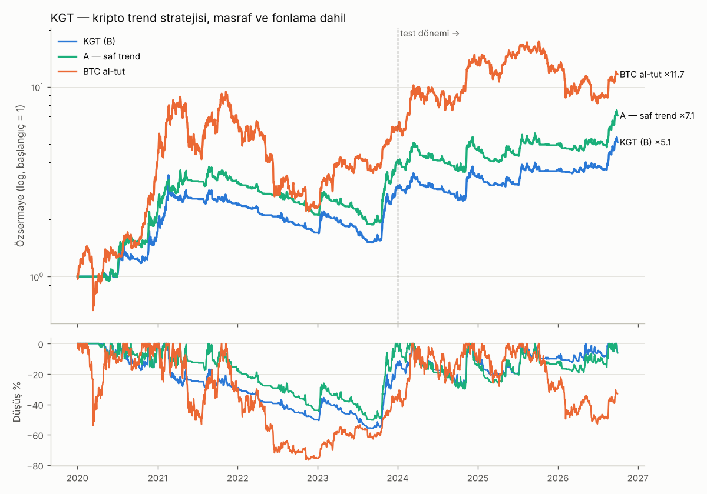
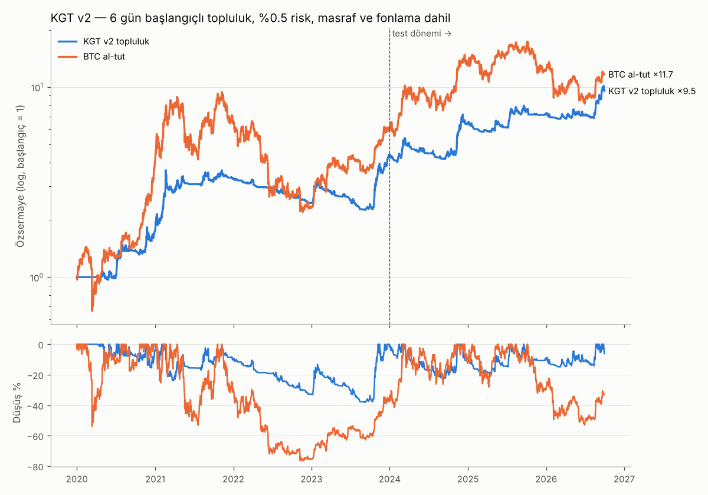
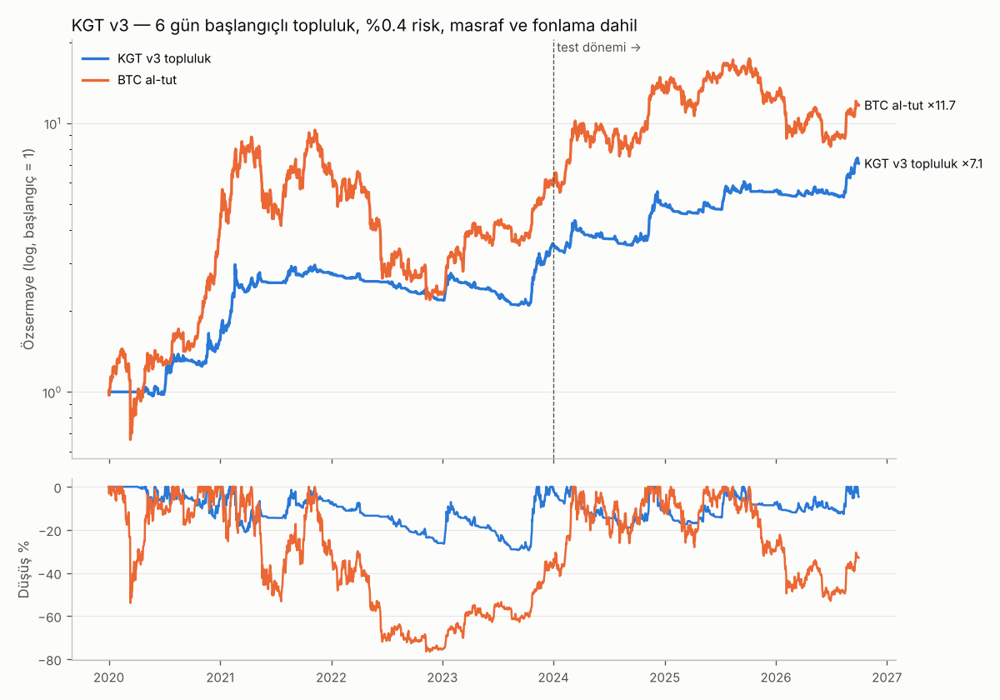

# Kripto Trend Stratejisi — KGT (Kripto Günlük Pivot Kırılımı + Trend Takibi)

**Yapı:** 1 Gün yön → 1 Saat giriş → 4 Saat trendi sürme. Yalnız long. Binance USDT-M vadeli.
**Veri:** 2020-01 → 2026-09. Masraf ve fonlama dahil.
**Ölçütler:** kazanma oranı ≥ %45 ve sağlamlık. Sağlamlık için şunlar arandı: test dönemi (2024+) kârlı, komşu parametrelerde kârlı, maliyet artışına dayanıklı, rastgele girişlerden anlamlı derecede iyi.

---

## 1. Kurallar

| Adım | Kural | PDF kaynağı |
|---|---|---|
| **Evren** | Her ayın başında, son 30 günlük USDT hacmine göre **ilk 10 coin** (en az 90 günlük geçmiş). Borsadan çıkanlar dahil; stabil, hisse ve emtia tokenleri hariç. | — |
| **Yön (1G)** | Günlük **EMA(10) > EMA(20)**, ve bugünün CPR'si **dar**: \|TC−BC\| ≤ 0,25 × günlük ATR(14). Pivot seviyeleri önceki UTC gününden hesaplanır. | 51 Str. 2.7 (dar CPR = trend günü), 2.3 (pivot), 20 Str. #6/#11 (üst zaman dilimi trend filtresi) |
| **Giriş (1S)** | 00:00–20:00 UTC arasında bir 1S mumu **R1'in üstünde kapanırsa** (önceki mum R1'in altındaysa) bir sonraki saatin açılışında **long**. Günde coin başına en fazla 1 giriş. | 51 Str. 2.7 (seviye kırılımı), 20 Str. #7 (kutu kırılımı), Galen (sıkışıklık bölgesi) |
| **Stop** | **S1** seviyesi; mesafe 0,75–3 × ATR(14, 1S) aralığına sıkıştırılır. | 20 Str. #7 (stop kutunun karşı ucunda) |
| **Kısmi kâr** | Fiyat **+1R**'ye ulaşınca pozisyonun **1/4'ü** kapatılır, stop **giriş fiyatına** çekilir. | 20 Str. #9, #18 |
| **Çıkış (4S)** | 4 saatlik **EMA(21) < EMA(50)** ve kapanış EMA21'in altındaysa, bir sonraki 1S açılışında kalan pozisyon kapatılır. | 20 Str. #6 (dizilim bozulunca çık), 151 Str. trend takibi |
| **Risk** | İşlem başına özsermayenin **%1'i**. Tek pozisyon en fazla %25. En fazla **5 eşzamanlı pozisyon**, kaldıraçsız (toplam ≤ özsermaye). | — |
| **Masraf** | Taraf başına %0,07 (komisyon + kayma), gerçek fonlama oranları her 8 saatte bir. | — |

---

## 2. Sonuçlar

| | İşlem | Kazanma | PF | Yıllık büyüme | Maks. düşüş | Sharpe | Calmar |
|---|---|---|---|---|---|---|---|
| **KGT — tüm dönem** | 1.335 (198/yıl) | **%45,5** | **1,61** | %21,9 | %58,2 | 0,75 | 0,38 |
| KGT — IS 2020–2023 | 779 | %44,9 | 1,66 | %22,0 | %58,2 | 0,72 | 0,38 |
| **KGT — OOS 2024–2026/09** | 556 | **%46,4** | **1,54** | %21,6 | **%29,0** | 0,76 | **0,74** |
| A — saf trend (kısmi kâr yok), tüm dönem | 1.040 | %23,5 | 1,84 | %44,7 | %59,8 | 1,07 | 0,75 |
| A — saf trend, OOS | 444 | %23,0 | 1,58 | %30,3 | %31,3 | 0,87 | 0,97 |
| BTC al-tut, tüm dönem | — | — | — | %43,9 | %77,2 | 0,91 | 0,57 |
| BTC al-tut, OOS | — | — | — | %27,9 | %53,8 | 0,73 | 0,52 |



**Yıllık getiri (%)**

| Yıl | KGT | A (saf trend) | BTC al-tut | KGT işlem | KGT kazanma | KGT PF |
|---|---|---|---|---|---|---|
| 2020 | +66,7 | +132,2 | +303,7 | 189 | %50,8 | 3,06 |
| 2021 | +0,6 | +103,5 | +59,6 | 239 | %41,4 | 0,86 |
| 2022 | **−27,3** | −38,0 | −64,2 | 133 | %45,9 | 0,36 |
| 2023 | +81,5 | +98,3 | +155,9 | 218 | %43,1 | 2,24 |
| 2024 | +16,9 | +43,2 | +121,1 | 221 | %47,5 | 1,51 |
| 2025 | **−13,9** | −12,6 | −6,4 | 174 | %39,7 | 0,98 |
| 2026 (9 ay) | +71,1 | +66,5 | −4,6 | 161 | %52,2 | 2,46 |

**Diğer:**
- Ortalama tutma süresi 2,9 gün (medyan 0,8 gün, en uzun 59 gün).
- İşlemlerin %66'sı stopla kapanıyor; kısmi kârdan sonra stop başabaşta olduğu için bunların bir kısmı sıfıra yakın.
- Fonlama maliyeti işlem başına ortalama −0,04R.

---

## 3. Sağlamlık

1. **Rastgele giriş kıyası (40 simülasyon).** Aynı coin, aynı yıl ve aynı sayıda giriş yapıldı; girişler günlük trend yukarı ve coin evrendeyken rastgele saatlerde açıldı. Stop dağılımı, kısmi kâr ve çıkış kuralları aynı tutuldu.
   - Rastgele medyan: PF 1,14, yıllık %6,2.
   - Gerçek strateji PF'de simülasyonların **%100'ünü**, yıllık büyümede ve test dönemi PF'sinde **%97'sini** geçiyor (p ≈ 0,03).
   - Sonuç: dar CPR + R1 kırılımı girişinin katkısı şans değil. Ama trend filtresi, büyük coin evreni ve trendi süren çıkış tek başına da hafif pozitif.
2. **Komşu parametreler.** Saf trend varyantında şunlar değiştirildi: CPR eşiği (0,18 / 0,35 / 0,5), seviye (R1 yerine önceki gün tepesi), 4S EMA'ları (10/30, 50/100), evren (ilk 5 / 15 / 20), pozisyon sayısı (3 / 10), risk (%0,5). Test dönemi PF'si hepsinde **1,34–1,58**.
   - İstisna 1: CPR'nin kendisini (TC) seviye olarak kullanmak, test PF 1,12.
   - İstisna 2: günlük trend filtresini kaldırmak, test PF 1,12. **Günlük filtre şart.**
3. **Maliyet 2 katına çıkarsa** test dönemi PF'si 1,47.
4. **Long/short** her ayarda long-only'den kötü (test PF 1,09). Bu dönemde short tarafı zarar ettirdi, bu yüzden long-only seçildi.
5. **Monte Carlo** (günlük getirilerin 20 günlük bloklarla 5.000 kez yeniden örneklenmesi, %1 risk):

| Ufuk | Getiri p5 | Medyan | p95 | Zarar olasılığı | Maks. düşüş medyan | p95 | p99 |
|---|---|---|---|---|---|---|---|
| 1 yıl | −%30 | +%18 | +%142 | **%32** | %25 | %42 | %48 |
| 3 yıl | −%34 | +%79 | +%463 | %18 | %37 | %59 | %67 |

6. **Coin dağılımı.** Kârın çoğu büyük coinlerden geliyor: BTC +94R, SOL +72R, ZEC +46R, LINK +38R, DOGE +33R, ETH +32R. BNB (−24R) ve BCH (−10R) en kötüleri.

---

## 4. Bu stratejide çalışmayanlar

| Yaklaşım | Sonuç |
|---|---|
| 1G+4S yön + 1S geri çekilme (RSI dip/toparlanma; 51 Str. Çift RSI, 20 Str. #6) | Eğitim dönemi kârlı, test dönemi PF ~0,95. Kâr birkaç dev trendden geliyor (DOGE 2021: tek işlem +%900). |
| 1G+4S yön + 1S Donchian kırılımı (51 Str. 3.6) | Test PF ~1,0; geniş evrende düşüş %60–90. |
| İlk 20–40 coin | Altcoinler aynı anda düşüyor; risk yoğunlaşıyor, test dönemi zayıf. |
| Göreli güç filtresi (coin BTC'den güçlü) | Katkı yok. |
| BTC rejim filtresi (BTC trendi yukarıyken alt long) | Eğitim döneminde iyi, testte kötü. |
| Saf günlük trend dönüşü (1S zamanlama yok) | Kararsız, test dönemi tutarsız. |
| Long/short | Short tarafı her ayarda zarar ettirdi. |

1.750'den fazla kombinasyon taranması sonucunda KGT seçildi.

---

## 5. Riskler ve dürüst değerlendirme

- **Seçim yanlılığı.** Test dönemine (2024+) birden çok kez bakıldı ve aday ondan sonra seçildi. Test sonuçları bu yüzden tam bağımsız değil. Rastgele kıyas ve komşu parametre testi bu riski azaltıyor ama yok etmiyor. **Gerçek parayla başlamadan önce 2–3 ay kâğıt üzerinde ileri test önerilir.**
- **Düşüş derin olabilir.** Şubat 2021'deki tepeden Eylül 2023'teki dibe %57 düşüş var (günlük kapanışlarla; saatlik en kötü %58). Önceki tepeye ancak Mart 2024'te dönülüyor, yani 3 yıl yeni zirve yok (%1 risk). İşlem başına %0,5 risk düşüşü yaklaşık yarıya indirir, getiriyi de.
- **BTC al-tut ile kıyas.**
  - Tüm dönemde: KGT getirisi BTC al-tut'tan düşük (%22'ye karşı %44 yıllık) ve risk-getirisi de düşük (Calmar 0,38'e karşı 0,57).
  - Test döneminde: KGT daha iyi (Calmar 0,74'e karşı 0,52).
  - Saf trend varyantı (A) her iki dönemde de BTC al-tut'tan iyi risk-getiri veriyor, ama kazanma oranı %23.
  - Yani **%45 kazanma hedefinin bedeli düşük getiri.**
- **Rejim bağımlılığı.** Trend takibi yatay ve ayı piyasalarında para kaybeder (2022, 2025). Strateji yalnız long olduğu için ayı piyasasında koruma işlem açmamaktan ibaret.
- **Uygulama.** Sinyaller 1S kapanışında üretiliyor, giriş bir sonraki açılışta. Gerçek kayma özellikle hareketli saatlerde varsayılandan yüksek olabilir.
- **Veri kaynağı.** Binance'in resmi kamu arşivi (`data.binance.vision`). Bu ortamda o alan adı engelli olduğu için aynı içerik izinli olan S3 kaynağından (`s3-ap-northeast-1.amazonaws.com/data.binance.vision`) çekildi.

---

## 6. Kullanım

```bash
# Backtest (veri bir kez indirilir; yaklaşık 26 bin dosya)
python3 -I backtest/kripto_veri.py semboller && python3 -I backtest/kripto_veri.py gunluk
python3 -I backtest/kripto_evren.py && python3 -I backtest/kripto_veri.py saatlik
python3 -m backtest.kripto_final              # özet, yıllık, coin, işlemler, grafik -> sonuclar/kripto/
python3 -m backtest.kripto_final rastgele     # rastgele giriş kıyası
python3 -m backtest.kripto_final montecarlo   # Monte Carlo

# Canlı sinyal (kendi bilgisayarınızda; Binance açık API, anahtar gerekmez)
python3 -m backtest.kripto_sinyal --sermaye 10000
```

**Sinyal betiğinin çıktısı:**
- **İzleme listesi:** ilk 10 coin için dar CPR, günlük trend, R1 tetik, S1 stop, 1R kısmi kâr seviyesi, 4S trend, pozisyon büyüklüğü.
- **Yeni sinyaller.**
- **Çıkış uyarıları:** 4S trendi aşağı dönen coinler.

Betik backtest ile aynı fonksiyonları kullanıyor; 25 rastgele geçmiş işlemde sinyal ve stop mesafesi **25/25 birebir eşleşti**. Saatlik çalıştırılmalı (her saat başını birkaç dakika geçe) ya da R1 seviyelerine fiyat alarmı kurulmalı.

**Dosyalar** (`sonuclar/kripto/`):
- `ozet.csv`, `yillik.csv`, `coin.csv`
- `islemler_KGT.csv`: tüm işlemler; giriş/çıkış, R, fonlama, sebep
- `montecarlo.csv`, `rastgele_kiyas.csv`
- `egri_KGT.png`

---

# KGT v2 — Al Brooks çalışması sonrası güncel sürüm (2026-10-09)

**Yeni kaynaklar:** Al Brooks, *Price Action Trends*, *Trading Ranges*, *En Başarılı 10 PA Modeli*. Metinler `metinler/` klasöründe.
**Hedef (kullanıcı):** kazanma oranı en az %40 şartıyla kârlılığı en üst düzeye çıkarmak.

## Brooks kurallarının test sonucu
- **Yüksek 1 / Yüksek 2 boğa bayrağı:** güçlü boğa sinyal mumu, Brooks trend gücü filtresi, 20 EMA iki kapanış çıkışı ve 2R swing hedefi ile kodlandı.
  - 4S'de (4 mum hizalamasının ortalaması) başarısız: test dönemi PF medyanı ~0,5.
  - 1S'de de başarısız. %40 kazanma ve iki dönemde pozitif Sharpe şartlarını birlikte sağlayan ayar yok.
- **KGT'ye Brooks eklentileri:**
  - "4S 20 EMA altında 2 kapanış" çıkışı: PF 1,99 → 1,53.
  - Güçlü kırılım mumu filtresi: getiri düşüyor.
  - İkisi de **iyileştirmedi**; eklenmedi.

## Değişiklikler (v1 → v2)

| | v1 | v2 |
|---|---|---|
| Evren | ilk 10 coin | **ilk 15 coin** |
| Kısmi kâr | 1R'de 1/4 | **1R'de %15** |
| Risk | işlem başına %1 | **%0,5** |
| Gün başlangıcı | tek (00:00 UTC) | **6 alt-portföy:** 00/04/08/12/16/20 UTC, sermaye/6 |

Giriş ve çıkış kuralları değişmedi: dar CPR + günlük EMA10/20 trend + 1S R1 kırılımı; 4S EMA21/50 dönüşünde çıkış.

**6 alt-portföy nedir:** aynı strateji, günlük pivotların hesaplandığı gün başlangıcı 4'er saat kaydırılarak 6 kez çalıştırılır. Girişler zamana yayılır, tek bir zamanlamanın şans etkisi ortadan kalkar. Tek alt-portföyle %0,5 risk: yıllık %27, düşüş %56. Altısı birlikte: yıllık %40, düşüş %38.

## Sonuçlar (masraf %0,07/taraf ve gerçek fonlama dahil)

| | Kazanma | PF | Yıllık | Maks. düşüş | Sharpe | Calmar |
|---|---|---|---|---|---|---|
| **KGT v2 topluluk, 2020–2026/09** | **%44,4** | **1,95** | **%39,7** | **%38,2** | **1,27** | **1,04** |
| KGT v2, IS 2020–2023 | %44,4 | 2,07 | %44,4 | %38,2 | 1,28 | 1,16 |
| **KGT v2, OOS 2024–2026/09** | %44,5 | 1,78 | %32,4 | %22,3 | 1,26 | 1,45 |
| KGT v1 (ilk 10, %1 risk, tek gün başı) | %45,5 | 1,61 | %21,9 | %58,2 | 0,75 | 0,38 |
| BTC al-tut | — | — | %43,8 | %76,7 | 0,91 | 0,57 |



**Yıllık getiri (%):**

| Yıl | 2020 | 2021 | 2022 | 2023 | 2024 | 2025 | 2026 (9 ay) |
|---|---|---|---|---|---|---|---|
| KGT v2 topluluk | +75,5 | +86,5 | **−24,9** | +76,7 | +46,9 | +13,1 | +32,2 |
| BTC al-tut | +303,7 | +59,6 | −64,2 | +155,9 | +121,1 | −6,4 | −4,6 |

## Sağlamlık
- **Rastgele giriş kıyası** (40 simülasyon, tek gün başı): gerçek strateji PF'de ve yıllık büyümede %100'ünü, test dönemi PF'sinde %93'ünü geçiyor. Rastgele medyan: PF 1,23, yıllık %8,9.
- **Gün başlangıcı kaydırma:** 6 kaydırmanın 6'sında da kârlı.
- **Maliyet:**
  - 2 katında: PF 1,83, yıllık %40, Sharpe 1,04, **kazanma %38**.
  - 3 katında: PF 1,68, yıllık %32, kazanma %32.
  - Kazanma oranı maliyete duyarlı, kârlılık değil.
- **Yürüyen pencere (2021–2026/09):** her yıl yalnız geçmiş veriyle, kazanma ≥ %40 olan adaylardan seçim yapıldı (evren 15/20, kısmi kâr varyantları, Brooks çıkışı). Sonuç: yıllık **%28,9**, düşüş %63, Sharpe 0,88 (%1 risk). Sabit v2 ayarı aynı dönemde %42,3. İlk yıllarda yanlış adaylar seçildi; 2024'ten itibaren v2'ye oturdu. **Gerçekçi beklenti: yıllık %29–40.**
- **Monte Carlo** (%0,5 risk, 20 günlük blok bootstrap):
  - 1 yıl: medyan +%36, zarar olasılığı %17, maks. düşüş medyanı %19, p95 %31.
  - 3 yıl: medyan +%164, zarar olasılığı %3.

## Kazanma oranı hakkında dürüst not
- Kazançların **%74'ü 0,3R'den küçük.** 1R'de pozisyonun %15'i kapanıyor, kalanı başabaş stopla çıkıyor; işlem net küçük kârla kapanıyor.
- Gerçek büyük kazanç (≥1R) işlemlerin yalnızca ~%8'i. Kârın kaynağı bu işlemler: ortalama kazanç 1,83R, ortalama kayıp −0,74R.
- %44'lük kazanma oranı bu yapının sonucu. Masraf yüksekse küçük kazançlar zarara döner ve oran %40'ın altına düşebilir; kârlılık ise korunur.

## Kullanım
```bash
python3 -m backtest.kripto_final topluluk           # v2 topluluk raporu -> sonuclar/kripto/*_v2_topluluk*
python3 -m backtest.kripto_sinyal --sermaye 10000   # her saat başı birkaç dakika geçe; 6 alt-portföyün sinyalleri
```

---

# KGT v3 — Faz 6: Brooks metinlerinin ayrıntılı taranması (2026-10-09)

> **Faz 9 denetim notu:** Düzeltilmiş motor ve sinyallerle sonuçlar değişmedi. Yapılan düzeltmeler: aynı mumdaki
> başabaş stopu 1 dakikalık veriyle çözüldü, HTF hizalaması canlı betikle aynı yapıldı, veri boşlukları ele alındı.
> Yeni sonuç: kazanma %45,5, PF 2,05, yıllık %33,6, düşüş %29,5, Sharpe 1,28, OOS Sharpe 1,31. Stop fiilen 3×ATR(1S)'dir;
> S1 stopu yalnız teorik, çünkü mesafe hep üst sınıra takılıyor. Ayrıntı: `DENETIM.md`.

**İstek:** %0,25 risk ve en fazla 3 pozisyonu test et (karar bende); Price Action metinlerinde kaçırılan noktaları bul, stratejiyi geliştir.

## Risk ve pozisyon sayısı (v2 kuralları, 6'lı topluluk)

| Risk / maks. pozisyon | Yıllık | Maks. düşüş | Sharpe | Calmar |
|---|---|---|---|---|
| %0,25 / 5 | %22,2 | %22,3 | 1,25 | 1,00 |
| %0,25 / 3 | %16,1 | %19,8 | 1,26 | 0,81 |
| %0,35 / 5 | %29,9 | %29,4 | 1,26 | 1,02 |
| %0,5 / 3 | %28,7 | %33,0 | 1,27 | 0,87 |
| %0,5 / 5 (v2) | %39,7 | %38,2 | 1,27 | 1,04 |

- Risk, getiriyi ve düşüşü **doğrusal** ölçekliyor. Sharpe değişmiyor (~1,26).
- 3 pozisyon her risk düzeyinde 5 pozisyondan kötü: Sharpe aynı ama Calmar düşük (aynı düşüşte daha az getiri), test döneminde (OOS) getiri yarıya iniyor (%0,25/3: OOS yıllık %9,5). **5 pozisyon kalıyor.**
- Seçim **%0,4**: yıllık ~%33, düşüş ~%31. %0,5 ile kâr hedefi ve %0,25 ile düşüş kaygısı arasında orta nokta. Daha sakin profil için %0,25 (düşüş ~%22) kullanılabilir.

## Brooks metinlerinden çıkarılıp test edilen kurallar
Her test 6 gün başlangıçlı topluluk üzerinde yapıldı. Bir kuralın kabulü için iki şart arandı: Sharpe/Calmar tabandan iyi olmalı, ve iyileşme yalnız IS ya da yalnız OOS döneminde değil, ikisinde de görülmeli.

| Kural (kaynak) | Sonuç | Karar |
|---|---|---|
| 4S salınım dibinin altında iz süren stop, k=2/3 (TR b.29) | Sharpe 1,27 → 1,09–1,12 | ✗ |
| Doruk sonrası girme: günlük uzama > 3/4 ATR'de giriş yok (Trends b.18) | değişim yok | ✗ |
| Günde 2. giriş, "ikinci girişler" (Trends b.10) | Sharpe 1,22 | ✗ |
| Kârdaki pozisyona ekleme, 2–3 kademe, 1R/2R eşik (TR b.31) | Calmar 1,04 → 0,80–0,95 | ✗ |
| "Önemli direnç": kırılım 5/10/20 günlük zirvenin de üstünde (10 Model, Kırılımlar) | Sharpe 0,65–0,98 | ✗ |
| Dar aralık (breakout mode): önceki gün NR4 / NR7 / iç gün | Sharpe 0,33–1,02, IS–OOS tutarsız | ✗ |
| Haftalık trend (kapanış > EMA10 / EMA10 > EMA20) | Sharpe 1,06–1,16, OOS bozuluyor | ✗ |
| Kırılım geri çekilmesi girişi (R1'e dönüp yeni zirve, 4 varyant) | tek başına Sharpe 0,76–0,82; tabana ek 1,23 | ✗ |
| **Günlük kapanış > EMA20 ("always-in long", 20 EMA'nın üstü = boğalar kontrolde)** | Sharpe 1,27, Calmar 1,04 → 1,08, düşüş −2,4 puan, OOS Sharpe 1,26 → 1,34 | **✓** |

**EMA20 şartının sağlamlığı:**
- **Komşu uzunluklar:** EMA10 / 15 / 20 / 30 tutarlı (Calmar 1,00–1,08). EMA50 kötü (Calmar 0,80).
- **Maliyet ×2:** tabandan iyi (Calmar 0,76 → 0,83, kazanma %38,2 → %39,8).
- **Evren 20:** tabandan iyi (Calmar 0,92 → 0,97).
- **Not:** "EMA20 yükseliyor" ile "kapanış EMA20 üstünde" matematiksel olarak aynı koşul (EMA'nın değişimi = α × (kapanış − önceki EMA)).

**Dürüst değerlendirme:** iyileşme küçük. Kural az sayıda kötü girişi eliyor; işlem sayısı yılda 229'dan 179'a iniyor. Büyük sıçrama yok: bu giriş/çıkış yapısının üst sınırına yakınız. Brooks'un geri kalan fikirleri bu stratejide ya etkisiz ya zararlı çıktı.

## v3 sonuçları (%0,4 risk, 6'lı topluluk, masraf %0,07/taraf + fonlama)

| | Kazanma | PF | Yıllık | Maks. düşüş | Sharpe | Calmar |
|---|---|---|---|---|---|---|
| **KGT v3, 2020–2026/09** | **%45,4** | **2,00** | **%32,9** | **%30,6** | **1,26** | **1,08** |
| KGT v3, IS 2020–2023 | %44,6 | 2,08 | %35,9 | %30,6 | 1,25 | 1,17 |
| **KGT v3, OOS 2024–2026/09** | %46,7 | 1,88 | %28,5 | %18,9 | 1,31 | 1,50 |
| KGT v2 (%0,5 risk) | %44,4 | 1,95 | %39,7 | %38,2 | 1,27 | 1,04 |
| KGT v2 (%0,35 risk, aynı düşüş düzeyi) | %44,4 | 1,95 | %29,9 | %29,4 | 1,26 | 1,02 |

Aynı düşüş düzeyinde v3, v2'den yılda ~3 puan fazla kazandırıyor. Kazanma oranı %45'in üstüne çıktı.



| Yıl | 2020 | 2021 | 2022 | 2023 | 2024 | 2025 | 2026 (9 ay) |
|---|---|---|---|---|---|---|---|
| KGT v3 | +55,6 | +70,4 | **−19,7** | +59,8 | +42,5 | +13,8 | +23,7 |
| Kazanma % | 42,8 | 44,9 | 40,3 | 48,5 | 45,0 | 44,8 | 51,1 |
| BTC al-tut | +303,7 | +59,6 | −64,2 | +155,9 | +121,1 | −6,4 | −4,6 |

**Kayıplar ve stoplar (v3):**
- Fiyat stopu medyanı %3,9, p90 %7,8.
- Ortalama kayıp alt portföy özsermayesinin %0,35'i. En kötü tek işlem −%0,9 (gap nedeniyle −2,25R).
- Kazançların %73'ü 0,3R'nin altında (kısmi kâr + başabaş stop). İşlemlerin %9'u ≥1R; kârın kaynağı bunlar.

**Monte Carlo** (topluluk getirileri, 20 günlük blok bootstrap, 5000 yol):
- 1 yıl: medyan +%30, p5 −%12, zarar olasılığı %16, maks. düşüş medyanı %16, p95 %27.
- 3 yıl: medyan +%132, p5 +%9, zarar olasılığı %3.

**Rastgele giriş kıyası** (tek gün başı, 40 simülasyon): gerçek strateji PF ve yıllık büyümede rastgele girişlerin %97'sini, OOS PF'de %85'ini geçiyor.

**Canlı sinyal betiği doğrulaması:**
- 20 rastgele v3 işleminin 20'sinde aynı sinyal üretildi.
- Yalnız v2'de olan 20 işlemin 20'sinde sinyal üretilmedi.

## Kullanım
```bash
python3 -m backtest.kripto_final topluluk            # v3 -> sonuclar/kripto/*_v3_topluluk*
python3 -m backtest.kripto_final montecarlo          # topluluk getirileriyle
python3 -m backtest.kripto_sinyal --sermaye 10000    # her saat başı birkaç dakika geçe
```
Test betikleri ve ham sonuçlar: `sonuclar/brooks/d3–d7.pkl`.
