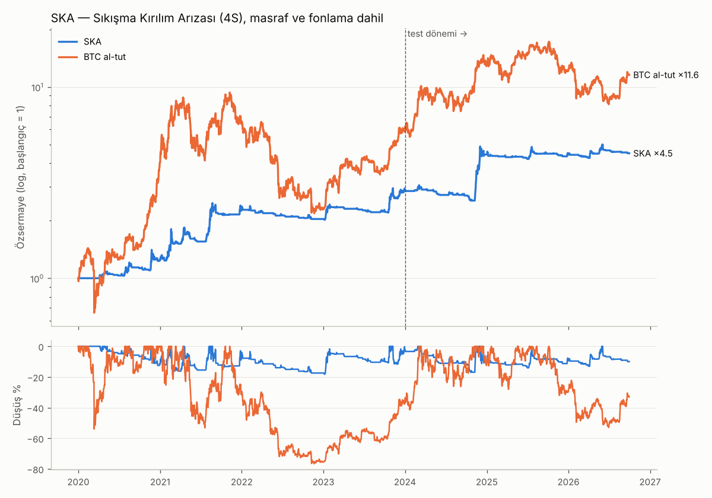

# Price Action Stratejisi — SKA (Sıkışma Kırılım Arızası)

**Kaynak:** Galen Woods, *Price Action ile Günlük Trading Teknikleri*, Cilt 3, Bölüm 2: "Tıkanıklık Giderme Arızası" (Congestion Breakout Failure). Giriş ve stop için kitabın genel kuralı (Bölüm 1.5): kurulum mumunun bir tık üstüne alış stop emri, bir tık altına zarar durdur.
**Piyasa:** Binance USDT-M vadeli; her ay hacme göre ilk 20 coin. Yalnız long, **4 saatlik grafik**.
**Veri:** 2020-01 → 2026-09; masraf (%0,07/taraf) ve gerçek fonlama oranları dahil.
**Dönemler:** eğitim (IS) 2020–2023, test (OOS) 2024–2026/09.

---

## 1. Fikir

Galen'in yaklaşımı: piyasa yönünde işlem yap, yanlış tarafta kalan **karşı-trend tüccarların** zorunlu pozisyon kapatmasından faydalan. Yükseliş eğiliminde oluşan bir sıkışmada fiyat aşağı kırılır; karşı-trend satıcılar girer ve kırılım hemen başarısız olur. Bu satıcıların stoplarının patlaması, trend yönündeki hareketi hızlandırır.

## 2. Kurallar

| Adım | Kural |
|---|---|
| **Eğilim (4S)** | EMA(21) > EMA(50) ve kapanış EMA21'in üstünde. Yalnız kapanmış mumlar kullanılır. Eğilim yukarıyken yalnız long. |
| **1. Tıkanıklık** | En az **4 ardışık mum**, her biri bir önceki mumun yüksek–düşük aralığı **içinde kapanır** (fitil dışarı taşabilir). |
| **2. Sahte kırılım** | Tıkanıklıktan sonraki mum, önceki mumun **dibinin altında kapanır** (düşüş kırılım mumu). |
| **3. Kurulum mumu** | Hemen ardından gelen mum **yükseliş mumu** (kapanış > açılış). |
| **Giriş** | Kurulum mumunun tepesi + 0,02 × ATR seviyesine **alış stop emri**, yalnız bir sonraki 4S mumu boyunca geçerli; dolmazsa iptal. |
| **Stop** | Kurulum mumunun dibi − 0,02 × ATR. Mesafe en az 1 × ATR(14, 4S). |
| **Kısmi kâr** | +1R'de pozisyonun **1/4'ü** kapatılır, stop **giriş fiyatına** çekilir. |
| **Çıkış** | 4S eğilimi bozulunca (EMA21 < EMA50 ve kapanış EMA21 altı), bir sonraki 4S açılışında. |
| **Risk** | İşlem başına özsermayenin **%1'i**. Tek pozisyon en fazla %25, en fazla 5 eşzamanlı pozisyon, kaldıraçsız. |

## 3. Sonuçlar

| | İşlem | Kazanma | PF | Yıllık büyüme | Maks. düşüş | Sharpe | Calmar |
|---|---|---|---|---|---|---|---|
| **SKA tüm dönem** | 309 (46/yıl) | **%54,0** | **3,18** | %25,0 | **%21,8** | 1,07 | **1,15** |
| SKA IS 2020–2023 | 187 | %53,5 | 3,00 | %30,4 | %18,4 | 1,14 | 1,65 |
| **SKA OOS 2024–2026/09** | 122 | **%54,9** | **3,44** | %17,6 | **%17,9** | 0,97 | 0,98 |
| BTC al-tut tüm dönem | — | — | — | %43,8 | %77,1 | 0,91 | 0,57 |
| BTC al-tut OOS | — | — | — | %28,1 | %53,4 | 0,73 | 0,53 |
| *Kıyas: KGT (önceki strateji), tüm dönem* | 1.335 | %45,5 | 1,61 | %21,9 | %58,2 | 0,75 | 0,38 |



| Yıl | SKA | BTC al-tut | İşlem | Kazanma | PF |
|---|---|---|---|---|---|
| 2020 | +24,6 | +300,9 | 44 | %52,3 | 3,34 |
| 2021 | +84,7 | +59,6 | 63 | %58,7 | 4,40 |
| 2022 | **−11,4** | −64,2 | 32 | %37,5 | 0,40 |
| 2023 | +41,5 | +155,9 | 48 | %58,3 | 3,57 |
| 2024 | +53,7 | +121,1 | 57 | %49,1 | 5,43 |
| 2025 | +0,7 | −6,4 | 42 | %64,3 | 1,06 |
| 2026 (9 ay) | +0,8 | −4,6 | 23 | %52,2 | 1,36 |

**Diğer:**
- **En derin düşüş:** %18,3 (Ağustos 2021 → Ocak 2023), toparlanma Ekim 2023'te.
- **Bugünkü durum:** son zirveden (Haziran 2026) %10 aşağıda.
- **Tutma süresi:** ortalama 4,0 gün, medyan 0,8 gün.
- **Stop mesafesi:** medyan fiyatın %3,2'si.

## 4. Sağlamlık

1. **Rastgele giriş kıyası (40 simülasyon).** Aynı coin, aynı yıl ve aynı sayıda giriş; 4S eğilimi yukarıyken rastgele mumlarda açıldı. Aynı stop dağılımı, kısmi kâr ve çıkış kullanıldı.
   - Rastgele medyan: PF 1,18, yıllık %3,5, düşüş %37.
   - SKA kâr faktöründe **%100'ünü**, test dönemi kâr faktöründe **%100'ünü**, yıllık büyümede %97'sini geçiyor.
   - Sonuç: avantaj kurulumun kendisinden geliyor.
2. **Komşu parametreler.** Değiştirilenler: tıkanıklık uzunluğu (3 / 5), evren (10 / 15 / 30 coin), stop tabanı (0,5 / 0,75 / 1,5 ATR), kısmi kâr (1/3, 1/2, 0,75R, 1,5R, hiç), eğilim (4S + 1G, yalnız 1G), long/short, 1G çıkış. **19 varyantın hepsinde** eğitim PF ≥ 1,79 ve test PF ≥ 1,44.
   - Tıkanıklık 3 mum: test PF 1,90.
   - Tıkanıklık 5 mum: test PF 6,85, ama az işlem.
3. **Maliyet.** 1,5 katında test PF 3,32, 2 katında 3,21. 4S'de stoplar geniş olduğu için masraf etkisi küçük.
4. **Monte Carlo** (günlük getirilerin 20 günlük bloklarla 5.000 kez yeniden örneklenmesi):

| Ufuk | Getiri p5 | Medyan | p95 | Zarar olasılığı | Maks. düşüş medyan | p95 | p99 |
|---|---|---|---|---|---|---|---|
| 1 yıl | −%13 | +%21 | +%106 | %21 | %14 | %24 | %29 |
| 3 yıl | −%2 | +%91 | +%351 | %6 | %20 | %33 | %40 |

5. **Kâr yoğunlaşması (en önemli risk).**
   - En iyi 5 işlem toplam R'nin %73'ü, en iyi 10 işlem %94'ü. Geri kalan ~300 işlem toplamda yaklaşık başa baş.
   - Tek başına XRP Kasım 2024 işlemi +133R getirdi (özsermayeye +%59).
   - XRP tamamen çıkarılsa bile: 288 işlem, PF 2,01, kazanma %53,5, +138R.
   - Yüksek kazanma oranı, 1R'deki küçük kısmi kâr ve başabaş stoptan geliyor; asıl getiri ayda bir-iki yakalanan büyük trendlerden. **Kurulum her ay kâr getirmez; büyük trend gelmeyen dönemler yatay geçer.** 2025–2026 böyle bir dönem: +%0,7 ve +%0,8.

## 5. Bu çalışmada elenenler

Bütün kurulumlar aynı kurallarla test edildi: eğilim yönünde, bekleyen emirle giriş, stop kurulum mumunun ötesinde.

| Zaman dilimi | Kurulum | Test dönemi medyan PF | Sonuç |
|---|---|---|---|
| **1 saat** | Tüm kurulumlar (TBF, CBF, DEC, ANT, PZ, WPB, PIN, hepsi birlikte) | 0,75–0,88 | ❌ 1S'de stop ~%1,1, gidiş-dönüş masraf %0,14 (stopun ~%13'ü); kurulumlar çok sık ve gürültülü |
| 4 saat | Trend Çubuğu Arızası (TBF) | 0,80 | ❌ |
| 4 saat | Yavaşlama (DEC) / Doruğa Karşı (ANT) | 0,83 | ❌ Birkaç iyi ayar var ama işlem az ve kırılgan |
| 4 saat | Basınç Bölgesi (PZ) | 0,81 | ❌ |
| 4 saat | Zayıf Geri Çekilme (WPB) | 0,86 | ❌ Eğitimde iyi (PF 2,4), testte 0,5 |
| 4 saat | Pin bar (51 Str. 7.3) | 0,82 | ❌ |
| **4 saat** | **Tıkanıklık Kırılım Arızası (CBF)** | **1,00 (odaklı ızgarada 1,20)** | ✅ Odaklı ızgarada 972 ayarın 270'i iki dönemde PF > 1,3 |

Toplam yaklaşık 2.900 kombinasyon tarandı.

## 6. Riskler ve dürüst değerlendirme

- **Seçim yanlılığı.** Kurulum, iki zaman diliminde 7 kurulum taranarak seçildi ve test dönemi sonuçları seçimde görüldü. Rastgele kıyas, geniş komşu parametre alanı ve tek bir coin çıkarılınca bile kârlı kalması bu riski azaltıyor ama yok etmiyor. **Gerçek parayla başlamadan önce 2–3 ay kâğıt üzerinde ileri test önerilir.**
- **Az sayıda büyük trende bağımlı.** Yıllarca yatay gidebilir (2025–2026). Büyük bir trendi kaçırmak ya da erken çıkmak yıllık sonucu belirler.
- **BTC al-tut ile kıyas.** Ham getiride BTC al-tut daha yüksek (%44'e karşı %25 yıllık). Risk-getiride SKA çok daha iyi: düşüş %22'ye karşı %77, Calmar 1,15'e karşı 0,57.
- **Yalnız long.** Ayı piyasasında koruma, işlem açmamaktan ibaret. 2022'de −%11 (BTC −%64).
- **Uygulama.** 4S mum kapanışından hemen sonra bekleyen emir girilmeli. Bekleyen stop emirlerinde hızlı piyasada kayma olabilir.

## 7. Kullanım

```bash
python3 -m backtest.pa_final              # özet, yıllık, coin, işlemler, grafik -> sonuclar/pa/
python3 -m backtest.pa_final komsu        # komşu parametre ve maliyet testi
python3 -m backtest.pa_final rastgele     # rastgele giriş kıyası
python3 -m backtest.pa_final montecarlo

# Canlı sinyal: her 4S kapanışından sonra (TSİ 03, 07, 11, 15, 19, 23); Binance açık API, anahtar gerekmez
python3 -m backtest.pa_sinyal --sermaye 10000
```

**Sinyal betiğinin çıktısı:**
- **Bekleyen emirler:** alış stop seviyesi, stop, 1R kısmi kâr seviyesi, pozisyon büyüklüğü.
- **Çıkış uyarıları:** eğilimi aşağı dönen coinler.
- **Eğilim tablosu:** ilk 20 coinin 4S eğilim durumu.

Betik backtest ile aynı fonksiyonları kullanıyor. 25 rastgele geçmiş işlemin **25'inde kurulum aynı mumda tespit edildi**; stop seviyeleri %0,01'den küçük farkla eşleşti (ATR'nin başlangıç penceresinden kaynaklanan yuvarlama).

**Kod:**
- `backtest/pa.py`: 7 kurulumun dedektörleri; short kurulumları fiyat ekseni ters çevrilerek simetrik
- `backtest/pa_arastirma.py`: ızgara
- `backtest/pa_final.py`: nihai strateji
- `backtest/kripto_motor.py`: bekleyen emir destekli portföy motoru

---

## 8. EK (sonradan yapılan test): Mum hizalama testi — sonuç büyük ölçüde şans

Strateji raporlandıktan sonra, kullanıcı "daha iyi hale getirelim" dedi. Önce stratejiyi daha sert bir testten geçirdim: **aynı kurallar, aynı 4 saatlik zaman dilimi, yalnızca mumların başladığı saat 1–3 saat kaydırıldı.** Gerçek bir piyasa davranışı bu değişikliğe duyarlı olmamalı.

| 4S mum başlangıcı (UTC) | Tüm dönem PF | Yıllık büyüme | Test dönemi PF |
|---|---|---|---|
| 00:00 (yukarıdaki sonuçlar) | 3,18 | %25,0 | 3,44 |
| 01:00 | 1,64 | %7,4 | 0,78 |
| 02:00 | 1,12 | −%1,0 | 0,78 |
| 03:00 | 2,74 | %17,9 | 4,26 |

**Diğer zaman dilimleri (aynı kural):**
- 2S, 8S, 12S ve 1G'de başarısız.
- 3S, 5S ve 6S'de zayıf ya da karışık.

**Sonuç:** SKA'nın %25'lik sonucunun önemli bir kısmı, hangi büyük trendlerin hangi mum hizalamasında yakalandığına bağlı bir şans. Rastgele giriş kıyası bunu yakalayamadı, çünkü aynı hizalamayı kullanıyordu.

**Gerçekçi beklenti:** sermaye 4'e bölünüp dört hizalama birlikte çalıştırıldığında yıllık **%12,9**, maks. düşüş %20,7, Sharpe 0,89. Test döneminde yıllık %7,4.

**Karşılaştırma: KGT bu teste dayanıklı.** Günlük pivotların hesaplandığı gün başlangıcı 0/4/8/12/16/20 UTC olarak kaydırıldığında altı ayarın hepsinde:
- tüm dönem PF 1,53–1,82
- test dönemi PF 1,26–1,60
- altısının ortalaması: yıllık %28,0, düşüş %48, Sharpe 0,92

| Portföy (masraf ve fonlama dahil) | Yıllık | Maks. düşüş | Sharpe | Calmar | Test dönemi yıllık / düşüş |
|---|---|---|---|---|---|
| SKA (4 hizalama ortalaması) | %12,9 | %20,7 | 0,89 | 0,62 | %7,4 / %11,8 |
| KGT (6 gün başı ortalaması) | %28,0 | %48,1 | 0,92 | 0,58 | %19,1 / %25,7 |
| **%50 SKA + %50 KGT** | **%21,3** | **%33,8** | **1,01** | **0,63** | **%14,0 / %17,3** |
| BTC al-tut | %43,8 | %76,7 | 0,91 | 0,57 | %26,1 / %53,0 |

SKA ile KGT'nin günlük getiri korelasyonu 0,55.

**Güncel değerlendirme:**
- SKA tek başına raporlandığı kadar güçlü değil. Mum hizalamasına bağımlılığı, kullanılmadan önce bilinmesi gereken ciddi bir zayıflık.
- En sağlam yapı, iki stratejinin hizalama ortalamalı birleşimi. Risk-getiri BTC al-tut'tan biraz iyi (Sharpe 1,01'e karşı 0,91), düşüş yarıdan az (%34'e karşı %77), ham getiri yaklaşık yarısı.
- Çalışma bu bulgunun üzerinden devam ediyor (bkz. DURUM.md, Faz 4).

## 9. EK: Yürüyen pencere (walk-forward) testi — nihai karar

2021'den itibaren her yıl için:
1. **Seçim:** yalnızca o yıldan önceki veriye bakılır; küçük bir aday kümesinden, mum hizalama ortalamalı Sharpe'a göre en iyi ayar seçilir.
   - KGT adayları: CPR eşiği 0,18 / 0,25 / 0,35; kısmi kâr yok / 1R'de 1/4; evren 5 / 10 / 15 coin. 6 gün başı ortalaması.
   - SKA adayları: tıkanıklık 3 / 4 / 5 mum; evren 10 / 20 / 30; stop tabanı 0,5 / 1 ATR. 4 hizalama ortalaması.
2. **Uygulama:** o yıl seçilen ayarla oynanır.

Bu, gerçek kullanımda beklenebilecek sonucun en dürüst ölçüsüdür.

| 2021 – 2026/09 | Yıllık | Maks. düşüş | Sharpe | Seçilen ayarlar |
|---|---|---|---|---|
| **KGT** | **%38,4** | %63,7 | **0,99** | Her yıl aynı aile: kısmi kâr **yok**, ilk **15** coin (CPR 0,35 → 0,25) |
| SKA | %4,2 | %27,0 | 0,36 | Her yıl değişiyor (kararsız) |
| %50 KGT + %50 SKA | %21,9 | %44,5 | 0,90 | — |
| BTC al-tut | %20,2 | %77,2 | 0,60 | — |

**Yıllık getiriler (%), yürüyen pencere:**
- **KGT:** 2021 +185, 2022 −48, 2023 +101, 2024 +38, 2025 +5, 2026 (9 ay) +49
- **SKA:** 2021 +29, 2022 −17, 2023 +16, 2024 +3, 2025 −5, 2026 (9 ay) +3

**Karar:**
- **SKA bırakılıyor.** Mum hizalama testini ve yürüyen pencere testini geçemedi; raporlanan %25'lik sonuç büyük ölçüde şanstı.
- **KGT, saf trend sürme varyantıyla en sağlam strateji.** Yürüyen pencerede BTC al-tut'tan açıkça iyi risk-getiri verdi ve ayar seçimi yıldan yıla tutarlı kaldı.
  - Bedeli 1: kazanma oranı ~%23.
  - Bedeli 2: %1 riskle düşüş %64'e kadar çıkabiliyor. %0,5 risk önerilir; düşüş yaklaşık yarıya iner, getiri de.
